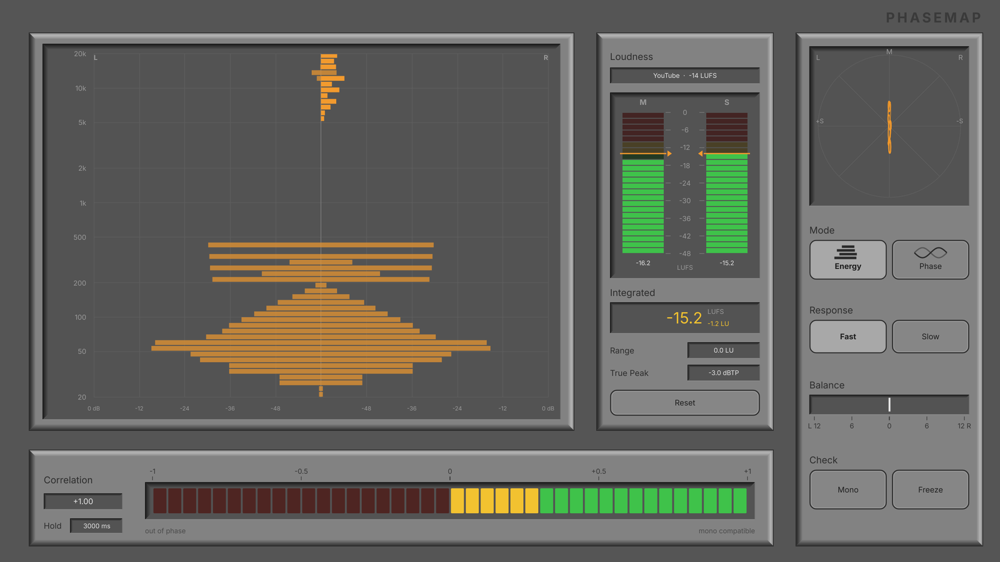
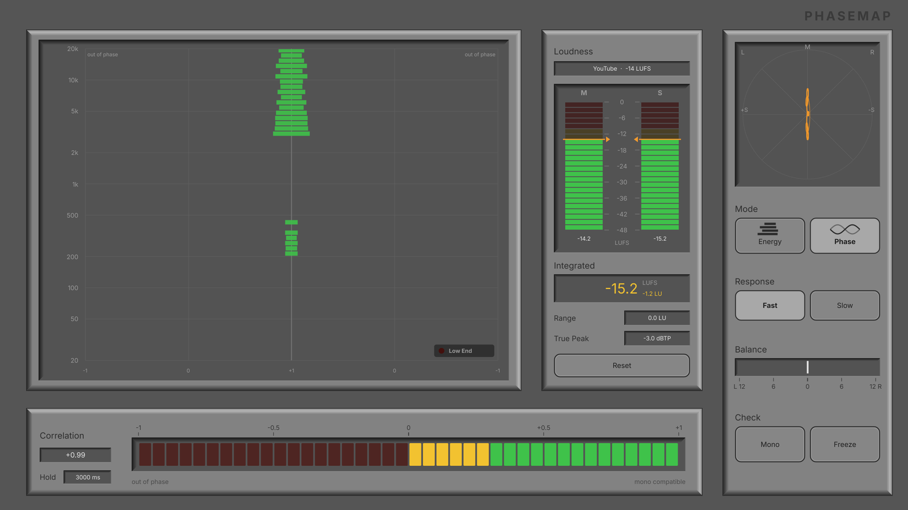
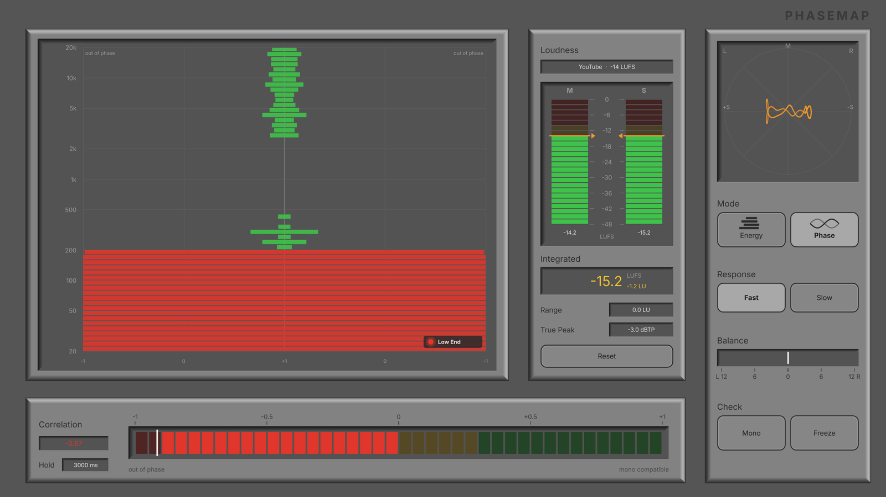

# Phasemap

**See where your mix cancels in mono, and how loud it really is.**
A free, open-source stereo phase and loudness meter by [Nullzone Audio](https://nullzone-audio.org).
**Status: Beta 1.0** - versions are named Beta 1.0, 1.1, ... until the first stable release.



## What it shows

| | |
|---|---|
| **Phase per frequency** | Correlation for every band from 20 Hz to 20 kHz. Centre = in phase, edge = cancels in mono, independent of level. A *Low End* lamp blinks when anything below 160 Hz is out of phase. |
| **Energy per frequency** | Level of L and R per band, mirrored. A lopsided shape means a band is panned or recorded unevenly. |
| **Loudness (EBU R128)** | Momentary, Short-term, Integrated (gated), Loudness Range and True Peak after ITU-R BS.1770-4, with targets for broadcast and streaming platforms, or your own. |
| **Overall** | Correlation meter with minimum hold, goniometer, L/R balance. |
| **Checks** | Mono button to listen to the sum, Freeze to stop the display. |

Hover any control for three seconds to get a short explanation.

| Phase: clean mix | Phase: bass polarity flipped in one channel |
|---|---|
|  |  |

## Formats

VST3, AU (macOS), CLAP, LV2 (Linux) and a standalone app, on macOS, Windows and Linux.
Mono and stereo tracks, any sample rate, any block size. Audio passes through untouched (unless Mono is on). No latency.

## Download

Ready-made builds are on the [Releases](../../releases) page.

> **macOS:** builds are not signed with an Apple developer certificate yet. After copying the plugin, run
> `xattr -dr com.apple.quarantine ~/Library/Audio/Plug-Ins/Components/Phasemap.component` (same for the `.vst3` / `.clap`).

## Build it yourself

You need CMake 3.22+ and a C++17 compiler (Xcode, Visual Studio 2022, GCC or Clang). JUCE and the CLAP extensions are downloaded automatically.

```bash
git clone https://github.com/nullzone-audio/phasemap.git
cd phasemap
cmake -B build -DCMAKE_BUILD_TYPE=Release
cmake --build build --config Release
ctest --test-dir build -C Release        # run the tests
```

The plugins end up in `build/Phasemap_artefacts/Release/`.
On Linux, install the JUCE dependencies first, see [the CI script](.github/workflows/build.yml).

Options: `-DPHASEMAP_BUILD_CLAP=OFF`, `-DPHASEMAP_BUILD_TESTS=OFF`, `-DPHASEMAP_BUILD_TOOLS=ON` (screenshot tool), `-DJUCE_DIR=/path/to/JUCE`.

## Accuracy

The loudness meter is tested against the EBU test signals (Tech 3341 and 3342) at 44.1 to 192 kHz and matches them within 0.1 LU.
The phase analysis is tested with signals whose answer is known (mono, inverted polarity, unrelated noise, a delay that cancels exactly at 1 kHz).
See [`tests/`](tests) - every check prints what it expects.

## Website

The source of nullzone-audio.org is in [`website/`](website): edit `site.html`, run `python3 website/build_site.py`, upload `index.html` and `images/`.
Showcase images for social media and press are in [`docs/showcase/`](docs/showcase).

## How it works / contributing

[docs/ARCHITECTURE.md](docs/ARCHITECTURE.md) explains the code in ten minutes, [docs/DEVELOPING.md](docs/DEVELOPING.md) shows how to open it in Xcode with a live UI inspector. Contributions are very welcome, see [CONTRIBUTING.md](CONTRIBUTING.md).
Good first issues: new loudness targets, translations of the hover texts, testing in your DAW.

## Deutsch

Phasemap zeigt pro Frequenz, wo sich ein Mix in Mono auslöscht, und misst die Lautheit nach EBU R128. Kostenlos und quelloffen (GPLv3).
Downloads unter *Releases*; Fragen und Fehlerberichte gern auch auf Deutsch in den *Issues*.

## License

GPL-3.0-or-later, see [LICENSE](LICENSE). Built with [JUCE](https://juce.com) (AGPLv3 / commercial) and [clap-juce-extensions](https://github.com/free-audio/clap-juce-extensions) (MIT).
VST is a registered trademark of Steinberg Media Technologies GmbH.
